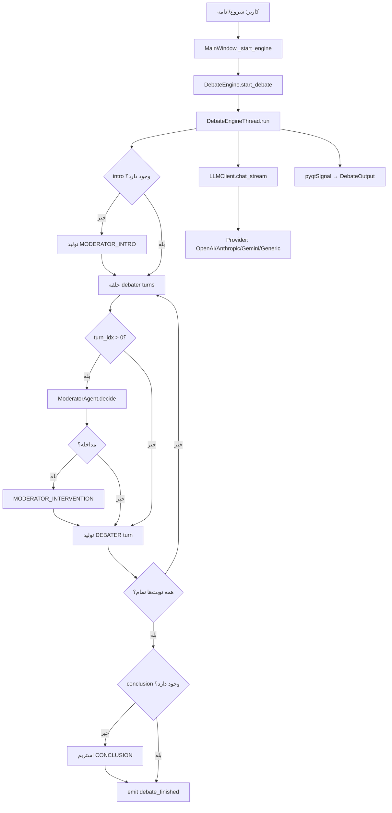

# DebateAI — مستندات فنی (فارسی)

این سند توضیح کامل معماری، جریان داده، و نقش **هر فایل** پروژه DebateAI را به زبان فارسی ارائه می‌دهد.

---

## فهرست

1. [معرفی کلی](#۱-معرفی-کلی)
2. [معماری و الگوهای طراحی](#۲-معماری-و-الگوهای-طراحی)
3. [جریان تولید مناظره](#۳-جریان-تولید-مناظره)
4. [مدیریت زمینه (Context) در پرامپت‌ها](#۴-مدیریت-زمینه-context-در-پرامپت‌ها)
5. [ساختار پوشه‌ها](#۵-ساختار-پوشه‌ها)
6. [توضیح فایل‌به‌فایل](#۶-توضیح-فایل‌به‌فایل)
7. [مدل‌های داده](#۷-مدل‌های-داده)
8. [اتصال به LLM](#۸-اتصال-به-llm)
9. [رابط کاربری (UI)](#۹-رابط-کاربری-ui)
10. [سیستم صوتی (Voice/TTS)](#۱۰-سیستم-صوتی-voicetts)
11. [ذخیره‌سازی و بارگذاری](#۱۱-ذخیره‌سازی-و-بارگذاری)
12. [وضعیت‌ها و ادامه مناظره](#۱۲-وضعیت‌ها-و-ادامه-مناظره)
13. [مدیریت خطا](#۱۳-مدیریت-خطا)
14. [وابستگی‌ها و اجرا](#۱۴-وابستگی‌ها-و-اجرا)
15. [نمودار جریان](#۱۵-نمودار-جریان)

---

## ۱. معرفی کلی

**DebateAI** یک اپلیکیشن دسکتاپ مبتنی بر **PyQt5** است که مناظره‌های فارسی بین دو هوش مصنوعی (با شخصیت‌های قابل تنظیم) را با حضور **مجری هوشمند** تولید می‌کند. همچنین ویژگی **تولید صوت خودکار** (TTS) از چند provider مختلف را پشتیبانی می‌کند.

| ویژگی | توضیح |
|--------|--------|
| نوع برنامه | دسکتاپ (Python + PyQt5) |
| زبان خروجی | فارسی |
| پایگاه داده | ندارد — داده‌ها در حافظه و فایل JSON/Markdown |
| صف کار (Queue) | ندارد — از `QThread` برای کارهای سنگین استفاده می‌شود |
| ارائه‌دهندگان LLM | OpenAI، Anthropic، Gemini، APIهای سازگار با OpenAI |
| تولید صوت (TTS) | Edge TTS (رایگان)، ElevenLabs API، Google Gemini TTS |
| Design Patterns | MVC، Strategy، Factory، Observer، Thread Worker، Abstract Base Class |

---

## ۲. معماری و الگوهای طراحی

### لایه‌بندی

```
┌─────────────────────────────────────────┐
│  ui/          →  رابط کاربری (View)     │
│  main_window  →  کنترلر (Controller)    │
├─────────────────────────────────────────┤
│  voice/       →  تولید صوت (TTS)       │
│  core/        →  منطق کسب‌وکار          │
│  models/      →  مدل‌های داده (Dataclass)│
│  utils/       →  ابزارهای کمکی         │
│  config.py    →  تنظیمات سراسری        │
└─────────────────────────────────────────┘
```

### الگوهای به‌کاررفته

| الگو | محل استفاده |
|------|-------------|
| **MVC** | `MainWindow` کنترلر؛ ویجت‌ها View؛ `_current_debate_data` حالت |
| **Strategy** | `LLMProvider` و پیاده‌سازی‌های مختلف در `core/providers/` |
| **Factory** | `create_provider()` برای ساخت provider LLM؛ `TTSFactory` برای TTS |
| **Abstract Base Class** | `TTSProvider` برای تمام TTS providers |
| **Observer (سیگنال PyQt)** | `DebateEngineThread` → UI از طریق `pyqtSignal` |
| **Thread Worker** | `DebateEngineThread`، `PromptOptimizerThread` |

---

## ۳. جریان تولید مناظره

وقتی کاربر «شروع مناظره» یا «ادامه مناظره» را می‌زند، مراحل زیر در `DebateEngineThread.run()` اجرا می‌شود:

### مرحله ۱ — معرفی مجری
- اگر intro قبلاً تولید نشده باشد، مجری موضوع، طرفین و قوانین را معرفی می‌کند.
- نوع نوبت: `TurnType.MODERATOR_INTRO`
- در حالت **resume**، اگر intro وجود داشته باشد، این مرحله رد می‌شود.

### مرحله ۲ — نوبت‌های مذاکره‌کنندگان
- `max_turns` = تعداد نوبت **هر طرف** (نه کل).
- مجموع نوبت‌های debater = `max_turns × 2`
- ترتیب: طرف اول → طرف دوم → طرف اول → ...
- **قبل از هر نوبت** (به جز اولین نوبت debater): مجری تصمیم می‌گیرد آیا مداخله کند یا نه.
- اگر مداخله لازم باشد: `TurnType.MODERATOR_INTERVENTION` تولید می‌شود.
- سپس نوبت debater با `TurnType.DEBATER` تولید می‌شود.

### مرحله ۳ — نتیجه‌گیری مجری
- پس از اتمام همه نوبت‌ها، مجری تحلیل و جمع‌بندی می‌کند.
- اگر conclusion از قبل وجود داشته باشد (مثلاً در resume)، دوباره تولید نمی‌شود.

### سیگنال‌های PyQt (موتور → UI)

| سیگنال | کاربرد |
|--------|--------|
| `turn_stream_start` | شروع استریم یک نوبت |
| `turn_chunk` | دریافت تکه‌متن در حین استریم |
| `turn_generated` | اتمام یک نوبت |
| `progress_updated` | پیشرفت نوار (current/total) |
| `debate_conclusion_chunk` | استریم نتیجه‌گیری |
| `debate_finished` | پایان مناظره |
| `error_occurred` | خطای تولید |
| `status_changed` | تغییر وضعیت (running, completed, ...) |

---

## ۴. مدیریت زمینه (Context) در پرامپت‌ها

**همه تاریخچه در هر درخواست ارسال نمی‌شود.** محدودیت‌ها:

| مرحله | تعداد نوبت‌های ارسالی |
|--------|------------------------|
| صحبت debater | **۵ نوبت آخر** (`history[-5:]`) |
| تصمیم مجری | **۸ نوبت آخر** |
| مداخله مجری | **۵ نوبت آخر** |
| نتیجه‌گیری مجری | **کل مناظره** (بدون محدودیت) |

علاوه بر تاریخچه، در هر درخواست debater این‌ها هم ارسال می‌شوند:
- موضوع مناظره
- قوانین نوشتاری (در system prompt)
- پرامپت شخصیت debater (در system prompt)

---

## ۵. ساختار پوشه‌ها

```
debate_ai/
├── main.py                      # نقطه ورود برنامه
├── config.py                    # تنظیمات و بارگذاری .env
├── .env.example                 # نمونه تنظیمات LLM
├── .gitignore                   # فایل‌های نادیده Git
├── readme.md                    # خلاصه معماری (انگلیسی — ممکن است قدیمی باشد)
├── TECHNICAL_FA.md              # همین سند (مستندات کامل فارسی)
│
├── core/                        # منطق اصلی
│   ├── __init__.py
│   ├── debate_engine.py         # موتور مناظره + QThread
│   ├── llm_client.py            # واسط LLM + retry
│   ├── prompt_optimizer.py      # بهینه‌سازی پرامپت
│   ├── moderator_agent.py       # منطق تصمیم‌گیری مجری
│   ├── moderator_prompts.py     # قالب پرامپت‌های مجری
│   └── providers/               # پیاده‌سازی providerها
│       ├── __init__.py
│       ├── base.py
│       ├── factory.py
│       ├── openai_provider.py
│       ├── anthropic_provider.py
│       ├── gemini_provider.py
│       └── generic_provider.py
│
├── models/                      # مدل‌های داده
│   ├── __init__.py
│   ├── debater.py
│   ├── debate_config.py
│   ├── debate_turn.py
│   ├── debate_status.py
│   └── debate_project.py
│
├── ui/                          # رابط کاربری
│   ├── __init__.py
│   ├── main_window.py           # کنترلر اصلی + layout
│   ├── custom_messagebox.py     # MessageBox سفارشی (تیره/روشن)
│   ├── styles.py                # تم تیره (Dark Theme)
│   └── widgets/
│       ├── __init__.py
│       ├── debater_card.py      # کارت ورودی debater
│       ├── moderator_card.py    # کارت ورودی مجری
│       └── debate_output.py     # نمایش خروجی
│
├── voice/                       # تولید صوت (TTS)
│   ├── __init__.py
│   ├── base.py                  # Abstract Base Class (TTSProvider)
│   ├── edge_tts_provider.py     # Microsoft Edge TTS (رایگان)
│   ├── elevenlabs_provider.py   # ElevenLabs API
│   ├── gemini_provider.py       # Google Gemini TTS
│   ├── factory.py               # Factory Pattern
│   ├── config.py                # تنظیمات صوتی
│   ├── manager.py               # مدیر مرکزی صوتی
│   ├── utils.py                 # توابع کمکی صوتی
│   ├── examples.py              # مثال‌های استفاده
│   └── README.md                # مستندات ماژول صوت
│
├── utils/
│   ├── __init__.py
│   └── file_handler.py          # JSON + Markdown
│
├── test.py                      # تست ذخیره/بارگذاری پروژه
└── test_optimize.py             # تست streaming بهینه‌سازی
```

---

## ۶. توضیح فایل‌به‌فایل

### ریشه پروژه

#### `main.py`
**نقش:** نقطه ورود (Entry Point) برنامه.

**کارکرد:**
- ساخت `QApplication` با استایل Fusion
- نمایش `MainWindow`
- مدیریت خطاهای سطح بالا با `try/except` و خروج با کد ۱

**وابستگی‌ها:** `PyQt5`, `ui.main_window.MainWindow`

---

#### `config.py`
**نقش:** تنظیمات سراسری و بارگذاری متغیرهای محیطی.

**کارکرد:**
- تابع `_load_dotenv()`: خواندن فایل `.env` از کنار پروژه (بدون کتابخانه python-dotenv)
- متغیرهای LLM: `LLM_PROVIDER`, `LLM_MODEL`, `LLM_API_KEY`, `LLM_BASE_URI`, ...
- تنظیمات مناظره: `MAX_TURNS_DEFAULT = 50`, `TEMPERATURE = 0.8`
- تنظیمات UI: `WINDOW_WIDTH = 1400`, `WINDOW_HEIGHT = 900`

**نکته:** اگر `.env` وجود نداشته باشد، مقادیر پیش‌فرض استفاده می‌شوند.

---

#### `.env.example`
**نقش:** نمونه فایل تنظیمات برای کپی به `.env`.

**شامل:** provider، model، API key، base URI، header احراز هویت، temperature و مثال‌های OpenRouter/سرویس سفارشی.

---

#### `.gitignore`
**نقش:** فایل‌هایی که Git نادیده می‌گیرد.

**شامل:** `.env`, `.venv`, پوشه `debates/` (خروجی‌های export)

---

#### `readme.md`
**نقش:** خلاصه معماری به انگلیسی.

**توجه:** بخش‌هایی از این فایل ممکن است با کد فعلی (مثل resume و مداخله مجری) هم‌خوان نباشند. مرجع دقیق‌تر: **همین سند (`TECHNICAL_FA.md`)**.

---

#### `test.py`
**نقش:** اسکript نمایشی برای تست ذخیره/بارگذاری پروژه.

**کارکرد:**
- ساخت یک `DebateProject` نمونه با ۲ نوبت
- ذخیره JSON در `debates/demo_project.json`
- بارگذاری مجدد
- ذخیره نسخه متنی با `save_project_text()`

**اجرا:** `python test.py`

---

#### `test_optimize.py`
**نقش:** تست streaming بهینه‌سازی پرامپت بدون UI.

**کارکرد:**
- نیاز به `QCoreApplication` برای سیگنال‌های PyQt
- فراخوانی `PromptOptimizer.optimize()` با callbackهای chunk/success/error
- چاپ chunkها در ترمینال

**اجرا:** `python test_optimize.py` (نیاز به API key معتبر)

---

### پوشه `core/` — منطق اصلی

#### `core/__init__.py`
**نقش:** export کلاس‌های اصلی ماژول core.

**صادرات:** `LLMClient`, `PromptOptimizer`, `DebateEngine`

---

#### `core/debate_engine.py`
**نقش:** قلب سیستم — حلقه تولید مناظره.

**کلاس‌ها:**

| کلاس | توضیح |
|------|--------|
| `DebateEngineThread` | `QThread` — حلقه اصلی تولید در پس‌زمینه |
| `DebateEngine` | فکتوری — شروع/توقف thread و اتصال callbackها |

**متدهای مهم `DebateEngineThread`:**
- `run()` — حلقه intro → debater turns → conclusion
- `_generate_intro()` — معرفی مجری
- `_moderator_decide()` — پرسش از LLM برای تصمیم مداخله
- `_generate_intervention()` — تولید متن مداخله
- `_generate_debater_turn()` — تولید صحبت debater
- `_generate_conclusion()` — نتیجه‌گیری نهایی
- `_build_debater_prompt()` — ساخت user prompt با **۵ نوبت آخر**
- `_stream_llm()` — wrapper برای streaming + emit سیگنال‌ها
- `stop()` — توقف همکارانه با flag `_is_running`

**پارامترهای resume:**
- `existing_turns` — نوبت‌های قبلی
- `existing_conclusion` — اگر وجود داشته باشد، conclusion دوباره تولید نمی‌شود
- `resume=True` — رد کردن intro برای پروژه‌های legacy

---

#### `core/llm_client.py`
**نقش:** لایه میانی بین منطق برنامه و providerها.

**متدها:**

| متد | توضیح |
|-----|--------|
| `chat()` | درخواست یک‌جا؛ خطا را به صورت رشته `[خطا...]` برمی‌گرداند |
| `chat_stream()` | استریم با **۳ بار retry** (تأخیر ۸، ۱۶، ۳۲ ثانیه) برای خطاهای موقت |
| `optimize_prompt()` | بهینه‌سازی پرامپت (بدون استریم) |
| `optimize_prompt_stream()` | بهینه‌سازی با استریم |

**Retry برای:** Timeout، 502/503/504، ResourceExhausted

**نکته:** اگر قبل از خطا chunk دریافت شده باشد، retry انجام نمی‌شود.

---

#### `core/prompt_optimizer.py`
**نقش:** بهینه‌سازی پرامپت شخصیت‌ها در thread جداگانه.

**کلاس‌ها:**
- `PromptOptimizerThread` — worker در QThread
- `PromptOptimizer` — فکتوری با لیست `_active_threads`

**ثابت‌ها:** `PURPOSE_DEBATER`, `PURPOSE_MODERATOR`

**سیگنال‌ها:** `chunk`, `optimized`, `error`

---

#### `core/moderator_agent.py`
**نقش:** لایه تصمیم‌گیری و ساخت پرامپت مجری.

**انواع:**
- `ModeratorAction`: `continue`, `ask_question`, `summarize`, `challenge_speaker`
- `ModeratorDecision`: action + reason + target_speaker

**متدها:**
- `build_intro_prompts()` — پرامپت معرفی
- `decide()` — تصمیم JSON برای مداخله (۸ نوبت آخر)
- `build_intervention_prompts()` — پرامپت مداخله (۵ نوبت آخر)
- `build_conclusion_prompts()` — پرامپت نتیجه‌گیری (**کل تاریخچه**)
- `_parse_decision()` — پارس JSON از پاسخ LLM

---

#### `core/moderator_prompts.py`
**نقش:** قالب‌های متنی (Template) پرامپت مجری — جدا برای ویرایش آسان.

**ثابت‌ها:**
- `INTRO_SYSTEM`, `INTRO_USER` — معرفی
- `DECISION_SYSTEM`, `DECISION_USER` — تصمیم مداخله
- `INTERVENTION_SYSTEM`, `INTERVENTION_USER` — متن مداخله
- `CONCLUSION_SYSTEM`, `CONCLUSION_USER` — نتیجه‌گیری
- `ACTION_LABELS`, `ACTION_INSTRUCTIONS` — برچسب و دستور هر نوع مداخله

---

### پوشه `core/providers/` — اتصال به LLM

#### `core/providers/base.py`
**نقش:** کلاس انتزاعی پایه `LLMProvider`.

**متدهای abstract:** `chat()`, `chat_stream()`

**متد کمکی:** `_build_auth_value()` — ساخت مقدار header احراز هویت

---

#### `core/providers/factory.py`
**نقش:** فکتوری ساخت provider.

**نگاشت:**
- `openai` → `OpenAIProvider`
- `anthropic` → `AnthropicProvider`
- `gemini` → `GeminiProvider`
- هر چیز دیگر → `GenericProvider`

---

#### `core/providers/openai_provider.py`
**نقش:** اتصال به API سازگار با OpenAI (SDK رسمی `openai`).

**ویژگی‌ها:** `max_tokens=2000`, streaming با `stream=True`

---

#### `core/providers/anthropic_provider.py`
**نقش:** اتصال به Claude (SDK `anthropic`).

**تفاوت:** system prompt جدا از messages؛ streaming با `messages.stream()`

---

#### `core/providers/gemini_provider.py`
**نقش:** اتصال به Google Gemini (SDK `google-genai`).

**تفاوت:** system و user در یک prompt ترکیب می‌شوند؛ streaming با `generate_content_stream()`

**نکته:** پارامتر `temperature` در کد فعلی به API پاس داده نمی‌شود.

---

#### `core/providers/generic_provider.py`
**نقش:** fallback برای APIهای سازگار با OpenAI (OpenRouter، سرویس‌های سفارشی).

**ویژگی‌ها:**
- override header احراز هویت (`auth_header_name`, `auth_token_prefix`)
- `_normalize_response()` — پشتیبانی فیلدهای reasoning/thinking
- fallback: اگر streaming شکست بخورد، کل پاسخ یک‌جا ارسال می‌شود

---

#### `core/providers/__init__.py`
**صادرات:** `create_provider`

---

### پوشه `models/` — مدل‌های داده

#### `models/debater.py`
**کلاس `Debater`:**
- `name` — نام نمایشی (پیش‌فرض: «ناشناس»)
- `prompt` — دستورالعمل شخصیت
- `role` — `"debater"` یا `"moderator"`
- `to_dict()` / `from_dict()` — سریال‌سازی JSON

---

#### `models/debate_config.py`
**کلاس `DebateConfig`:**
- `topic`, `debater1`, `debater2`, `moderator`, `max_turns`, `temperature`
- `validate()` — اعتبارسنجی قبل از شروع (topic، نام طرفین، max_turns بین ۱ تا ۲۰۰)

**نکته UI:** spinbox تعداد نوبت در UI محدوده ۱–۱۰۰ دارد، ولی validate تا ۲۰۰ را می‌پذیرد.

---

#### `models/debate_turn.py`
**کلاس `DebateTurn`:**
- `speaker`, `content`, `turn_number`, `turn_type` (پیش‌فرض: `DEBATER`)
- سریال‌سازی با `turn_type` به صورت string

---

#### `models/debate_status.py`
**انواع:**

| Enum | مقادیر |
|------|--------|
| `DebateStatus` | pending, running, completed, failed, stopped |
| `TurnType` | debater, moderator_intro, moderator_intervention |

**کلاس `GenerationError`:**
- `message`, `step`, `timestamp`
- `now()` — ساخت با زمان فعلی ISO

---

#### `models/debate_project.py`
**کلاس `DebateProject`:**
- `config`, `turns`, `conclusion`, `exported_output_path`, `status`, `generation_error`
- `to_dict()` / `from_dict()` — JSON کامل پروژه
- `is_resumable()` — آیا می‌توان ادامه داد؟
- `debater_turns_completed()` — شمارش نوبت‌های debater
- `has_intro()` — آیا intro تولید شده؟

---

#### `models/__init__.py`
**صادرات:** `Debater`, `DebateConfig`

---

### پوشه `ui/` — رابط کاربری

#### `ui/main_window.py`
**نقش:** کنترلر اصلی (MVC) — اتصال UI به core.

**وظایف:**
- ساخت layout: پنل چپ (تنظیمات، عرض: 580-700px) + پنل راست (خروجی)
- مدیریت `_current_debate_data` — حالت در حافظه
- `_start_engine(resume=False/True)` — شروع یا ادامه مناظره
- `_can_resume()` — بررسی امکان ادامه
- `_build_debate_markdown()` — ساخت محتوای Markdown برای export
- handlerهای ذخیره/بارگذاری پروژه و export Markdown
- `_on_optimize_prompt()` — اتصال کارت‌ها به `PromptOptimizer`
- `_on_save_file()` — نمایش QFileDialog برای انتخاب مسیر ذخیره
- `closeEvent()` — توقف threadها هنگام بستن برنامه

**دکمه‌ها:**
- شروع مناظره / ادامه / توقف
- ذخیره/بارگذاری پروژه JSON
- API Key (اختیاری — override کلید config)

**ویژگی جدید:** Dialog برای export Markdown (برخلاف قبل که اتوماتیک بود)

---

#### `ui/custom_messagebox.py`
**نقش:** QMessageBox سفارشی با تم تیره.

**ویژگی‌ها:**
- زمینه سیاه (#0f1024) + متن سفید (#f2f5fb)
- متدهای static: `information()`, `warning()`, `critical()`, `question()`
- استایل QSS برای دکمه‌ها (hover effect)

**استفاده:**
```python
from ui.custom_messagebox import CustomMessageBox
CustomMessageBox.information(self, "عنوان", "پیام")
```

---

#### `ui/styles.py`
**نقش:** تم تیره (Dark Theme) با QSS.

**ثابت:** `DARK_THEME` — رنگ‌های `#101123`, `#e94560`, استایل دکمه‌ها، progress bar، group box

---

#### `ui/widgets/debater_card.py`
**نقش:** کارت ورودی برای هر debater.

**اجزا:** نام، پرامپت (QTextEdit)، دکمه بهینه‌سازی

**سیگنال:** `optimize_requested(text, purpose, name)`

**متدهای streaming بهینه‌سازی:** `begin_optimized_stream()`, `append_optimized_chunk()`, `finish_optimized_stream()`

---

#### `ui/widgets/moderator_card.py`
**نقش:** ارث‌بری از `DebaterCard` برای مجری.

**تفاوت:** placeholder متفاوت، `purpose="moderator"` در بهینه‌سازی

---

#### `ui/widgets/debate_output.py`
**نقش:** نمایش خروجی مناظره با پشتیبانی streaming.

**ویژگی‌ها:**
- نمایش live chunk در حین تولید
- رندر Markdown با `markdown2` پس از اتمام هر نوبت
- نوار پیشرفت
- برچسب وضعیت (running, completed, failed, stopped)
- دکمه ذخیره فایل و پاک کردن

**متدهای کلیدی:** `add_turn()`, `start_turn_stream()`, `append_turn_chunk()`, `finalize_streamed_turn()`, `set_conclusion()`, `reset()`

---

#### `ui/widgets/__init__.py`
**صادرات:** `DebaterCard`, `ModeratorCard`, `DebateOutput`

---

### پوشه `voice/` — تولید صوت (TTS)

**نقش:** سیستم تولید صوت مبتنی بر Design Patterns — پشتیبانی از چند provider مختلف.

#### `voice/base.py`
**نقش:** Abstract Base Class برای تمام TTS providers.

**کلاس‌ها:**
- `TTSConfig`: dataclass برای تنظیمات صوتی (language, speed, pitch, volume)
- `TTSProvider`: abstract base class برای تمام providers

**متدهای abstract:**
- `synthesize(text, speaker)` — تبدیل متن به bytes صوتی
- `get_available_voices()` — دریافت لیست voice های موجود
- `validate_credentials()` — بررسی صحت اعتبارات

---

#### `voice/edge_tts_provider.py`
**نقش:** اتصال به Microsoft Edge TTS.

**ویژگی‌ها:**
- رایگان — نیازمند API Key نیست
- voice های فارسی: `fa-IR-DilaraNeural` (دیلارا)، `fa-IR-FaridNeural` (فرید)
- استفاده از async/await با `asyncio`
- خروجی: MP3

**نصب:** `pip install edge-tts`

---

#### `voice/elevenlabs_provider.py`
**نقش:** اتصال به ElevenLabs API برای صوت کیفیت بالا.

**ویژگی‌ها:**
- نیازمند: ElevenLabs API Key
- 29+ languages
- voices: Rachel, Domi, Ava, Josh, Arnold, Sam و ...
- خروجی: MP3
- مدیریت Rate Limiting و خطاهای HTTP

**نصب:** `pip install requests`

---

#### `voice/gemini_provider.py`
**نقش:** اتصال به Google Gemini API برای تولید صوت Neural.

**ویژگی‌ها:**
- نیازمند: Google API Key
- voice های فارسی: `fa-IR-Standard-*`, `fa-IR-Neural2-*`
- خروجی: MP3 (base64 encoded)
- پشتیبانی pitch و speaking rate

**نصب:** `pip install requests`

---

#### `voice/factory.py`
**نقش:** Factory Pattern برای ایجاد TTS Provider instances.

**کلاس‌ها:**
- `TTSProviderType`: enum انواع providers (`EDGE_TTS`, `ELEVENLABS`, `GEMINI`)
- `TTSFactory`: factory برای ایجاد instances و ثبت providers سفارشی

**متد اصلی:** `TTSFactory.create(provider_type, api_key, config)`

**ویژگی:** پشتیبانی ثبت providers جدید با `register_provider()`

---

#### `voice/config.py`
**نقش:** تنظیمات سیستم صوتی.

**کلاس `VoiceConfig`:**
- `provider_type` — provider فعلی
- `elevenlabs_api_key`, `gemini_api_key` — API Keys
- `speech_rate`, `pitch`, `volume` — تنظیمات صوتی
- `debater1_voice`, `debater2_voice`, `moderator_voice` — انتخاب voice برای هر شخصیت
- `output_format`, `sample_rate` — تنظیمات فایل خروجی

**متدها:** `to_dict()`, `from_dict()` — سریال‌سازی برای JSON

---

#### `voice/manager.py`
**نقش:** مدیر مرکزی برای تمام عملیات صوتی.

**کلاس `VoiceManager`:**
- مدیریت lifecycle provider
- مقدار دهی اولیه اتوماتیک
- تبدیل پویا بین providers

**متدهای کلیدی:**
- `synthesize_text(text, speaker_type)` — تبدیل متن به صوت
- `save_audio(audio_data, filepath)` — ذخیره فایل صوتی
- `get_available_voices()` — دریافت voice های فعلی
- `validate_credentials()` — بررسی اعتبارات
- `switch_provider(provider_type, api_key)` — تبدیل به provider دیگر
- `update_voice_config()` — به‌روزرسانی تنظیمات

---

#### `voice/utils.py`
**نقش:** توابع کمکی برای کار با صوت.

**کلاس `VoiceUtils`:**
- `get_output_directory()` — ایجاد دایرکتوری خروجی
- `generate_audio_filename()` — تولید نام فایل صوتی
- `split_long_text()` — تقسیم متن طولانی (برای APIهای محدود)
- `get_file_size_mb()` — دریافت اندازه فایل
- `cleanup_old_files()` — حذف فایل‌های قدیمی‌تر از مدت زمان معین
- `validate_audio_file()` — بررسی صحت فایل صوتی

---

#### `voice/examples.py`
**نقش:** مثال‌های استفاده برای Voice Module.

**مثال‌های شامل:**
1. `example_edge_tts()` — استفاده ساده (رایگان)
2. `example_elevenlabs()` — استفاده با API
3. `example_gemini()` — استفاده Gemini
4. `example_provider_switching()` — تبدیل بین providers
5. `example_long_text_splitting()` — تقسیم متن طولانی
6. `example_full_debate_generation()` — تولید صوت برای کل مناظره

---

#### `voice/README.md`
**نقش:** مستندات کامل ماژول Voice.

**شامل:**
- معماری و Design Patterns
- توضیح هر provider
- آموزش استفاده
- لیست available voices
- نکات security
- Performance tips

---

#### `voice/__init__.py`
**صادرات:** `TTSProvider`, `TTSConfig`, `TTSFactory`, `TTSProviderType`, `VoiceConfig`, `VoiceManager`, `VoiceUtils`

#### `utils/file_handler.py`
**نقش:** عملیات فایل — JSON پروژه و export Markdown.

**متدها:**

| متد | کاربرد |
|-----|--------|
| `export_debate()` | ذخیره Markdown در `debates/` با timestamp |
| `_build_markdown()` | ساخت محتوای TTS-friendly |
| `save_project_json()` | ذخیره `DebateProject` |
| `load_project_json()` | بارگذاری پروژه |
| `save_project_text()` | export متنی ساده (فقط در test.py) |

**فرمت Markdown شامل:** معرفی شخصیت‌ها، متن کامل، نتیجه‌گیری، راهنمای TTS

---

## ۷. مدل‌های داده

### روابط

```
DebateProject
├── config: DebateConfig
│   ├── debater1: Debater
│   ├── debater2: Debater
│   └── moderator: Debater
├── turns: List[DebateTurn]
├── conclusion: str
├── status: DebateStatus
└── generation_error: GenerationError | None
```

### شماره‌گذاری نوبت‌ها
- `turn_number` از ۱ شروع می‌شود و برای **همه** انواع نوبت (intro، intervention، debater) یکتا و افزایشی است.
- در resume، از `max(existing) + 1` ادامه می‌یابد.

---

## ۸. اتصال به LLM

### متغیرهای محیطی (`.env`)

| متغیر | پیش‌فرض | توضیح |
|--------|---------|--------|
| `LLM_PROVIDER` | openai | openai / anthropic / gemini / custom |
| `LLM_MODEL` | gpt-4o-mini | نام مدل |
| `LLM_API_KEY` | — | کلید API |
| `LLM_BASE_URI` | api.openai.com/v1 | آدرس پایه |
| `LLM_AUTH_HEADER_NAME` | Authorization | نام header |
| `LLM_AUTH_TOKEN_PREFIX` | Bearer | پیشوند token |
| `LLM_TEMPERATURE` | 0.8 | دمای پیش‌فرض |

### دمای تولید در مناظره

| بخش | Temperature |
|-----|-------------|
| debater | `config.temperature` (پیش‌فرض 0.8) |
| intro / intervention / decision | 0.5 یا 0.3 |
| conclusion | 0.5 |

---

## ۹. رابط کاربری (UI)

### چیدمان

```
┌──────────────────┬────────────────────────────────────┐
│  پنل چپ (scroll) │  پنل راست — DebateOutput           │
│  - موضوع         │  - وضعیت                           │
│  - تعداد نوبت    │  - نوار پیشرفت                     │
│  - debater 1     │  - متن مناظره (streaming + MD)     │
│  - debater 2     │  - ذخیره / پاک کردن                │
│  - moderator     │                                    │
│  - دکمه‌ها       │                                    │
│  - API Key       │                                    │
└──────────────────┴────────────────────────────────────┘
```

### UX استریم
1. هنگام تولید: متن plain به صورت live نمایش داده می‌شود.
2. پس از اتمام نوبت: کل خروجی دوباره با Markdown رندر می‌شود.

---

## ۱۱. ذخیره‌سازی و بارگذاری

### پروژه JSON (اصلی)
- **ذخیره:** تنظیمات + نوبت‌ها + conclusion + status + خطا
- **بارگذاری:** پر کردن فرم‌ها + نمایش خروجی + فعال‌سازی «ادامه» در صورت امکان
- **مسیر:** `projects/` (انتخاب شده توسط کاربر از QFileDialog)

### Export Markdown
- جدا از JSON — برای TTS و اشتراک
- **مسیر:** نمایش QFileDialog برای انتخاب مسیر و نام فایل
- **فرمت:** Markdown با معرفی شخصیت‌ها، متن کامل، نتیجه‌گیری

### Export صوتی (پیش‌نویس)
- **مسیر:** `voice_output/` (خودکار)
- **ترتیب:** debater1 → debater2 → moderator (برای هر نوبت)
- **فرمت:** MP3 (قابل تنظیم)

### فیلد `exported_output_path`
- در schema وجود دارد ولی UI فعلاً آن را set نمی‌کند.

---

## ۱۲. وضعیت‌ها و ادامه مناظره

### چرخه وضعیت

```
PENDING → RUNNING → COMPLETED
              ↓
         STOPPED / FAILED
              ↓
         (resume ممکن)
```

### شرایط «ادامه مناظره»
- وضعیت FAILED، STOPPED، یا PENDING با نوبت‌های موجود
- conclusion وجود نداشته باشد (COMPLETED = غیرقابل resume)

### رفتار resume
- نوبت‌های قبلی به engine پاس داده می‌شوند
- intro تکرار نمی‌شود (مگر پروژه legacy بدون intro)
- از همان `turn_idx` ادامه می‌یابد که debater turns کامل نشده
- conclusion موجود skip می‌شود

---

## ۱۳. مدیریت خطا

| لایه | رفتار |
|------|--------|
| `main.py` | catch کلی → print + exit(1) |
| `DebateEngineThread` | `GenerationError` با step و timestamp |
| `LLMClient.chat()` | رشته خطا در پاسخ (بدون raise) |
| `LLMClient.chat_stream()` | retry + inject خطا در stream |
| `VoiceManager` | exception برای خطاهای TTS |
| `UI` | `CustomMessageBox` برای validation، خطا، ذخیره |

**اعتبارسنجی پاسخ:** پاسخ خالی یا شروع با `[خطا` → exception و FAILED

**خطاهای TTS:**
- `ValueError` — متن خالی یا اعتبارات نامعتبر
- `RuntimeError` — خطای API یا timeout

---

## ۱۴. وابستگی‌ها و اجرا

### کتابخانه‌های مورد نیاز (بر اساس importها)

```
PyQt5              # رابط کاربری
openai             # OpenAI API
anthropic          # Claude API
google-genai       # Gemini API
requests           # HTTP requests (برای generic و TTS providers)
markdown2          # رندر Markdown
edge-tts           # Microsoft Edge TTS (اختیاری)
```

### نصب

```bash
# نصب وابستگی‌های اساسی
pip install PyQt5 openai anthropic google-genai requests markdown2

# نصب TTS (اختیاری)
pip install edge-tts

# کپی تنظیمات
cp .env.example .env
# ویرایش .env برای API keys شما

# اجرا
python main.py
```

### متغیرهای محیطی (.env)

| متغیر | پیش‌فرض | توضیح |
|--------|---------|--------|
| `LLM_PROVIDER` | openai | openai / anthropic / gemini / custom |
| `LLM_MODEL` | gpt-4o-mini | نام مدل |
| `LLM_API_KEY` | — | کلید API |
| `LLM_BASE_URI` | api.openai.com/v1 | آدرس پایه |
| `LLM_AUTH_HEADER_NAME` | Authorization | نام header |
| `LLM_AUTH_TOKEN_PREFIX` | Bearer | پیشوند token |
| `LLM_TEMPERATURE` | 0.8 | دمای پیش‌فرض |

---

## ۱۵. نمودار جریان



---

## خلاصه نقش فایل‌ها

| فایل | یک خط توضیح |
|------|-------------|
| `main.py` | ورود برنامه |
| `config.py` | تنظیمات و env |
| `core/debate_engine.py` | موتور مناظره |
| `core/llm_client.py` | واسط LLM |
| `core/prompt_optimizer.py` | بهینه‌سازی پرامپت |
| `core/moderator_agent.py` | منطق مجری |
| `core/moderator_prompts.py` | قالب پرامپت مجری |
| `core/providers/*` | اتصال به APIهای مختلف |
| `models/*` | ساختار داده |
| `ui/main_window.py` | کنترلر UI |
| `ui/custom_messagebox.py` | MessageBox سفارشی |
| `ui/styles.py` | تم تیره |
| `ui/widgets/*` | ویجت‌های فرم و خروجی |
| `voice/base.py` | Abstract Base Class برای TTS |
| `voice/*_provider.py` | پیاده‌سازی TTS providers |
| `voice/factory.py` | Factory برای ایجاد TTS |
| `voice/config.py` | تنظیمات صوتی |
| `voice/manager.py` | مدیر مرکزی صوتی |
| `voice/utils.py` | توابع کمکی صوتی |
| `utils/file_handler.py` | JSON + Markdown |
| `test.py` | تست save/load |
| `test_optimize.py` | تست optimizer |

---

## ۱۰. سیستم صوتی (Voice/TTS)

### معماری

سیستم صوتی بر اساس **Design Patterns** ساخته شده تا پشتیبانی از چند TTS provider مختلف را فراهم کند:

```
┌──────────────────────────────────────┐
│  VoiceManager (رابط مرکزی)          │
├──────────────────────────────────────┤
│  TTSFactory (Factory Pattern)        │
├────┬────────────┬──────────────────┤
│ Edge│ ElevenLabs│ Google Gemini    │
│ TTS │ API       │ TTS              │
└────┴────────────┴──────────────────┘
```

### Providers موجود

| Provider | رایگان | نیاز API Key | فارسی | نکات |
|----------|--------|--------------|-------|------|
| Edge TTS | ✓ | ✗ | ✓ | رایگان، سریع، voice های محدود |
| ElevenLabs | ✗ | ✓ | ✗ | کیفیت عالی، 29+ languages |
| Gemini | ✗ | ✓ | ✓ | Neural voices، سنتز قوی |

### استفاده

```python
from core.voice import VoiceManager, VoiceConfig, TTSProviderType

# مثال 1: Edge TTS (رایگان)
config = VoiceConfig(provider_type=TTSProviderType.EDGE_TTS)
manager = VoiceManager(config)
audio = manager.synthesize_text("سلام")
manager.save_audio(audio, "output.mp3")

# مثال 2: تبدیل به ElevenLabs
manager.switch_provider(TTSProviderType.ELEVENLABS, api_key="...")
audio = manager.synthesize_text("متن جدید")

# مثال 3: تقسیم متن طولانی
from core.voice import VoiceUtils

chunks = VoiceUtils.split_long_text(long_text, max_length=5000)
```

### ترکیب با مناظره

مسیر پیش‌نویس برای ترکیب TTS با خروجی مناظره:

```python
# بعد از تولید مناظره
debate_manager = VoiceManager()

for turn in debate_data["turns"]:
    audio = debate_manager.synthesize_text(
        turn["content"],
        speaker_type=turn["speaker_type"]  # debater1, debater2, moderator
    )
    filename = VoiceUtils.generate_audio_filename(
        topic=debate_topic,
        speaker=turn["speaker"]
    )
    debate_manager.save_audio(audio, f"voice_output/{filename}")
```

---

*آخرین به‌روزرسانی این سند بر اساس کد موجود در پروژه DebateAI — نسخه V2 (شامل Voice Module و UI Improvements).*
