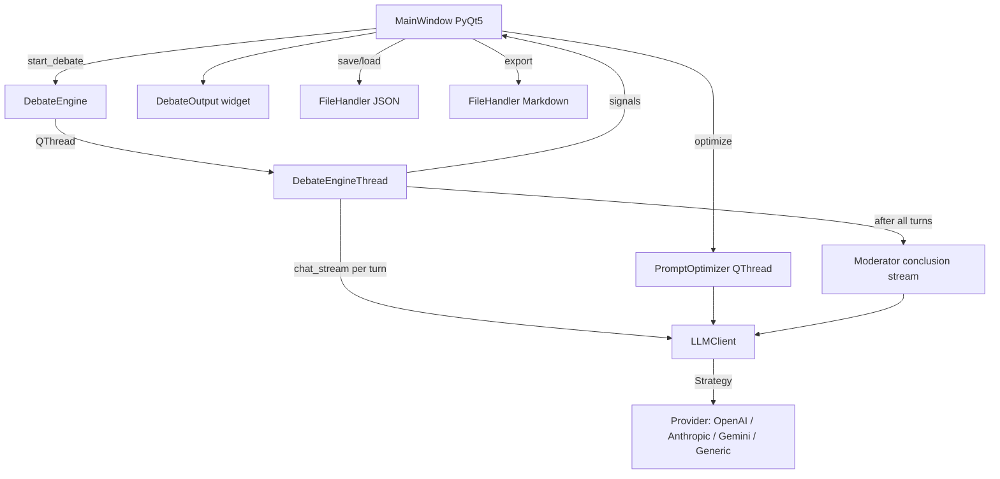

# DebateAI Project Architecture Summary

DebateAI is a **PyQt5 desktop application** (Python) for generating AI-vs-AI Persian debates with a moderator conclusion. It is **not** a web/backend service: there is **no database**, **no job queue**, and **no formal status/round persistence layer** beyond in-memory state and JSON/Markdown files.

---

## 1. Project Structure

```
C:\Projects\debate_ai\
├── main.py                    # Entry point → QApplication + MainWindow
├── config.py                  # Env loading, LLM + UI defaults
├── .env.example               # Sample LLM provider configuration
│
├── core/                      # Business logic
│   ├── debate_engine.py       # Debate loop + QThread orchestration
│   ├── llm_client.py          # LLM facade with retry/streaming
│   ├── prompt_optimizer.py    # Prompt optimization in QThread
│   └── providers/             # Strategy pattern for LLM backends
│       ├── base.py
│       ├── factory.py
│       ├── openai_provider.py
│       ├── anthropic_provider.py
│       ├── gemini_provider.py
│       └── generic_provider.py
│
├── models/                    # Dataclass domain models (not DB ORM)
│   ├── debater.py
│   ├── debate_config.py
│   └── debate_project.py
│
├── ui/                        # PyQt5 UI
│   ├── main_window.py         # Controller (MVC-style)
│   ├── styles.py              # Dark QSS theme
│   └── widgets/
│       ├── debater_card.py
│       ├── moderator_card.py
│       └── debate_output.py
│
├── utils/
│   └── file_handler.py        # JSON project save/load + Markdown export
│
├── test.py                    # Demo save/load project
└── test_optimize.py           # Prompt optimizer test
```

**Tech stack:** PyQt5, `openai` SDK, `anthropic`, `google-genai`, `requests`, `markdown2`. No `requirements.txt` found in the repo.

---

## 2. Debate Generation Architecture

### Core classes

| File                                          | Role                                                         |
| --------------------------------------------- | ------------------------------------------------------------ |
| `C:\Projects\debate_ai\core\debate_engine.py` | `DebateEngineThread` runs the debate loop; `DebateEngine` starts/stops it |
| `C:\Projects\debate_ai\core\llm_client.py`    | Wraps provider calls, streaming, retries                     |
| `C:\Projects\debate_ai\ui\main_window.py`     | Wires UI signals to engine callbacks                         |

### Turn model (not "rounds" in DB sense)

There is no separate **Round** entity. Each exchange is a `DebateTurn`:

```python
@dataclass
class DebateTurn:
    speaker: str
    content: str
    turn_number: int   # 1-indexed
```

- `max_turns` in config = **turns per debater** (each side).
- Total LLM calls for debaters = `max_turns * 2`.
- Turn order alternates: even index → debater1, odd → debater2 (0-based loop index).

### Step-by-step debate flow

1. **User clicks "شروع مناظره"** in `MainWindow._on_start_debate()`.
2. **Validation** via `DebateConfig.validate()` (topic, debater names, max_turns 1–200).
3. **Optional API key** from UI overrides `llm_client.api_key`.
4. **UI reset:** `output_widget.reset()`, disable Start / enable Stop.
5. **`DebateEngine.start_debate()`** stops any prior thread, creates `DebateEngineThread`, connects PyQt signals, starts thread.
6. **In `DebateEngineThread.run()`:**
   - Build shared `base_system` prompt (topic + debate rules in Persian).
   - **Loop** `for turn in range(total_turns)`:
     - Check `_is_running` (stop support).
     - Pick current debater (alternating).
     - Build **user prompt** with topic, identity, last 5 turns of history.
     - Build **system prompt** = base + debater name + debater personality prompt.
     - **Stream** response via `llm_client.chat_stream(...)`.
     - Emit `turn_chunk(turn_number, chunk)` for live UI.
     - Create `DebateTurn`, append to local history, emit `turn_generated`, `progress_updated`.
   - **After all debater turns** (if not stopped):
     - Build moderator prompts from full history.
     - Stream conclusion via `chat_stream(..., temperature=0.5)`.
     - Emit `debate_conclusion_chunk` per chunk, then `debate_finished(conclusion_text)`.
7. **UI callbacks:**
   - Chunks → live text in `DebateOutput`.
   - Completed turn → stored in `_current_debate_data['turns']`.
   - Conclusion → displayed + stored.
   - Progress bar updated.
8. **On finish:** re-enable Start, show success dialog; user can export Markdown.

### Prompt structure (debater turn)

**System prompt:**
- Debate topic and rules (Persian, 3–4 paragraphs max, no meta commentary).
- Debater name + custom personality prompt from UI.

**User prompt:**
- Topic, speaker identity.
- Up to **last 5 turns** of history (`speaker: content`).
- "Now it's your turn…"

### Moderator (post-debate only)

The moderator does **not** intervene between turns. It runs **once at the end**:

- Uses `config.moderator.prompt` plus fixed instructions (analyze strengths/weaknesses, neutral conclusion, summary).
- Receives full debate transcript.
- Streams conclusion at `temperature=0.5`.
- Deprecated non-streaming path: `_generate_conclusion()` (kept for compatibility).

---

## 3. Data Models and Fields

**There is no database.** Models are Python `@dataclass` objects serialized to JSON.

### `Debater` — `C:\Projects\debate_ai\models\debater.py`

| Field    | Type | Default           | Notes                           |
| -------- | ---- | ----------------- | ------------------------------- |
| `name`   | str  | `""` → `"ناشناس"` | Display name                    |
| `prompt` | str  | `""`              | Personality/system instructions |
| `role`   | str  | `"debater"`       | `"moderator"` for moderator     |

### `DebateConfig` — `C:\Projects\debate_ai\models\debate_config.py`

| Field         | Type    | Default                    |
| ------------- | ------- | -------------------------- |
| `topic`       | str     | `""`                       |
| `debater1`    | Debater | `"طرف اول"`                |
| `debater2`    | Debater | `"طرف دوم"`                |
| `moderator`   | Debater | `"مجری"`, role=`moderator` |
| `max_turns`   | int     | `50` (per side)            |
| `temperature` | float   | `0.8`                      |

**No status field.** Validation returns `(bool, message)` tuple only.

**Note:** `config.temperature` is saved/loaded but **not passed** to debater `chat_stream()` calls in the engine — those use `LLMClient` default (`TEMPERATURE` from env/`config.py`). Moderator uses hardcoded `0.5`.

### `DebateProject` — `C:\Projects\debate_ai\models\debate_project.py`

| Field                  | Type               | Notes                                  |
| ---------------------- | ------------------ | -------------------------------------- |
| `config`               | DebateConfig       | Full setup                             |
| `turns`                | `List[DebateTurn]` | Generated debate content               |
| `conclusion`           | str                | Moderator output                       |
| `exported_output_path` | `Optional[str]`    | In schema; **not set by UI** currently |

Methods: `to_dict()`, `from_dict()` for JSON round-trip.

### `DebateTurn` — defined in `debate_engine.py`, used across project

| Field         | Type |
| ------------- | ---- |
| `speaker`     | str  |
| `content`     | str  |
| `turn_number` | int  |

---

## 4. AI Services — LLM Providers and Prompts

### Configuration — `C:\Projects\debate_ai\config.py`

Loaded from `.env` (manual parser, not python-dotenv):

| Env var                          | Purpose                                                      |
| -------------------------------- | ------------------------------------------------------------ |
| `LLM_PROVIDER`                   | `openai`, `anthropic`, `gemini`, or fallback `GenericProvider` |
| `LLM_MODEL`                      | Model name                                                   |
| `LLM_API_KEY` / `OPENAI_API_KEY` | API key                                                      |
| `LLM_BASE_URI`                   | Custom endpoint                                              |
| `LLM_AUTH_HEADER_NAME`           | Auth header name                                             |
| `LLM_AUTH_TOKEN_PREFIX`          | e.g. `Bearer `                                               |
| `LLM_API_PATH`                   | Used in factory (GenericProvider relies on SDK path)         |
| `LLM_TEMPERATURE`                | Default generation temperature                               |

### Provider factory — `C:\Projects\debate_ai\core\providers\factory.py`

| Provider key  | Class                                      |
| ------------- | ------------------------------------------ |
| `openai`      | `OpenAIProvider`                           |
| `anthropic`   | `AnthropicProvider`                        |
| `gemini`      | `GeminiProvider`                           |
| anything else | `GenericProvider` (OpenAI-compatible APIs) |

All providers implement:
- `chat(system, user, temperature)` → full string
- `chat_stream(system, user, temperature, on_chunk)` → streaming

`GenericProvider` falls back to non-streaming `chat()` if stream fails.

### `LLMClient` — `C:\Projects\debate_ai\core\llm_client.py`

- **`chat()`:** catches exceptions, returns `"[خطا در اتصال به LLM: ...]"` string (does not raise).
- **`chat_stream()`:** up to **3 retries** with delays 8/16/32s for timeouts, 502/503/504, `ResourceExhausted`.
  - If chunks already received, no retry (appends error to stream).
  - On final failure, injects `"[خطا در LLM: ...]"` via `on_chunk`.
- **`optimize_prompt()` / `optimize_prompt_stream()`:** separate Persian prompt-engineering prompts for debater/moderator personas.

### Prompt optimizer — `C:\Projects\debate_ai\core\prompt_optimizer.py`

- Runs in `PromptOptimizerThread` (QThread).
- UI triggers from debater/moderator cards via `optimize_requested` signal.
- Streams optimized text back into the prompt text box.

---

## 5. Queue / Job System

**None.** Concurrency is handled entirely with **PyQt5 `QThread`**:

| Thread                  | Purpose                                                      |
| ----------------------- | ------------------------------------------------------------ |
| `DebateEngineThread`    | One active debate at a time                                  |
| `PromptOptimizerThread` | One or more concurrent optimizations (`PromptOptimizer._active_threads`) |

- No Celery, Redis, RQ, asyncio workers, or background job persistence.
- Starting a new debate calls `stop_debate()` on any running thread first.
- App shutdown (`closeEvent`) stops debate thread and `prompt_optimizer.cancel_all()` (uses `thread.terminate()`).

---

## 6. Save / Load Project Functionality

### JSON project (primary)

**`C:\Projects\debate_ai\utils\file_handler.py`**

- `save_project_json(project, filepath)` — writes `project.to_dict()` as UTF-8 JSON.
- `load_project_json(filepath)` — `DebateProject.from_dict()`.

**UI:** `MainWindow._on_save_project()` / `_on_load_project()` via file dialogs.

**Save includes:** config (topic, max_turns, temperature, all three personas), turns, conclusion.

**Load restores:**
- All form fields (topic, turns spin, debater/moderator cards).
- Output widget (turns + conclusion).
- `_current_debate_data` in-memory state.

### Markdown export (output file)

- `FileHandler.export_debate(...)` — TTS-friendly Markdown to `debates/` folder with timestamp.
- Triggered by "💾 ذخیره فایل" in output panel (`_on_save_file()`).
- Separate from project JSON; includes persona intros, all turns, conclusion, TTS guide.

### Plain text project export

- `FileHandler.save_project_text()` exists but is **only used in `test.py`**, not in the UI.

### `exported_output_path`

Field exists on `DebateProject` but is never populated by the application code today.

---

## 7. UI Components for Debate Generation

| File                                                 | Role                                                         |
| ---------------------------------------------------- | ------------------------------------------------------------ |
| `C:\Projects\debate_ai\ui\main_window.py`            | Main controller: config inputs, start/stop, save/load, signal wiring |
| `C:\Projects\debate_ai\ui\widgets\debater_card.py`   | Name + prompt + optimize button for each debater             |
| `C:\Projects\debate_ai\ui\widgets\moderator_card.py` | Extends `DebaterCard` for moderator (different placeholders, `purpose="moderator"`) |
| `C:\Projects\debate_ai\ui\widgets\debate_output.py`  | Live streaming display, progress bar, Markdown render on turn completion, save/clear |
| `C:\Projects\debate_ai\ui\styles.py`                 | Dark theme QSS                                               |

### Generation control in UI

- **Start:** validates → resets output → starts engine.
- **Stop:** `debate_engine.stop_debate()` sets `_is_running = False`; loop exits after current LLM call finishes (or waits up to 1s).
- **Progress:** `QProgressBar` shows `current/total` debater turns (not including moderator step).
- **Streaming UX:** chunks shown as plain text live; on turn complete, full turn re-rendered as Markdown HTML.

---

## 8. Moderator Implementation

| Aspect                  | Current behavior                                             |
| ----------------------- | ------------------------------------------------------------ |
| **When active**         | Only after all debater turns complete                        |
| **Input**               | Full transcript + topic + `moderator.prompt`                 |
| **Output**              | Single streamed conclusion/analysis                          |
| **Between-turn role**   | None — no opening, no turn announcements, no mid-debate intervention |
| **UI**                  | `ModeratorCard` for name/prompt; conclusion shown under "نتیجه‌گیری مجری" in `DebateOutput` |
| **Prompt optimization** | Same LLM optimizer with `purpose="moderator"`                |

Relevant code lives in `DebateEngineThread._build_moderator_prompts()` and the post-loop block in `run()`.

---

## Error Handling (Current State)

| Layer                          | Behavior                                                     |
| ------------------------------ | ------------------------------------------------------------ |
| **`main.py`**                  | Top-level try/except, prints traceback, exits 1              |
| **`DebateEngineThread.run()`** | Broad `except Exception` → `error_occurred.emit(str(e))`     |
| **`LLMClient.chat()`**         | Returns error string embedded in response (no exception to caller) |
| **`LLMClient.chat_stream()`**  | Retries transient errors; injects error text into stream on failure |
| **`MainWindow`**               | `QMessageBox` for validation, debate errors, save/load errors, optimize errors |
| **`DebateConfig.validate()`**  | Pre-flight validation before starting                        |
| **Stop mid-debate**            | Cooperative flag; partial turns may exist in UI/state; no moderator conclusion if stopped before end |

Errors in streaming debater turns may appear **inline in debate text** (from LLM client) rather than aborting the whole debate, unless an unhandled exception escapes the provider.

---

## Resume / Continue Logic

**No resume or continue-from-partial-turn implementation exists.**

What exists today:

| Feature                                             | Supported?                                                   |
| --------------------------------------------------- | ------------------------------------------------------------ |
| Load saved project with completed turns             | Yes — display only                                           |
| Start debate after load                             | Yes — but **always starts fresh** (`output_widget.reset()`, new thread, empty in-thread history) |
| Continue from turn N                                | **No**                                                       |
| Persist in-progress generation                      | **No** (only manual save of whatever is in `_current_debate_data`) |
| Status tracking (`pending`, `running`, `completed`) | **No formal model**                                          |
| Skip already-generated turns on restart             | **No**                                                       |

If the user stops mid-debate, partial turns remain in `_current_debate_data` and can be saved to JSON manually, but clicking Start again **clears the output and regenerates from turn 1**.

---

## Architecture Diagram



---

## Key Gaps / Observations (for future work)

1. **No database or status model** — everything is dataclasses + JSON files.
2. **No job queue** — single debate thread, UI-blocking concerns mitigated by QThread only.
3. **`config.temperature` unused** in debate generation loop.
4. **No resume** — load is for viewing/editing config + past output, not incremental generation.
5. **`exported_output_path`** field is unused in UI flow.
6. **Moderator is conclusion-only** — not a round-by-round facilitator.
7. **Duplicate imports** in `debate_project.py` (cosmetic, no functional impact).

If you want, I can next map exactly what would need to change to add **resume-from-turn-N** or **per-round moderator interjections**.